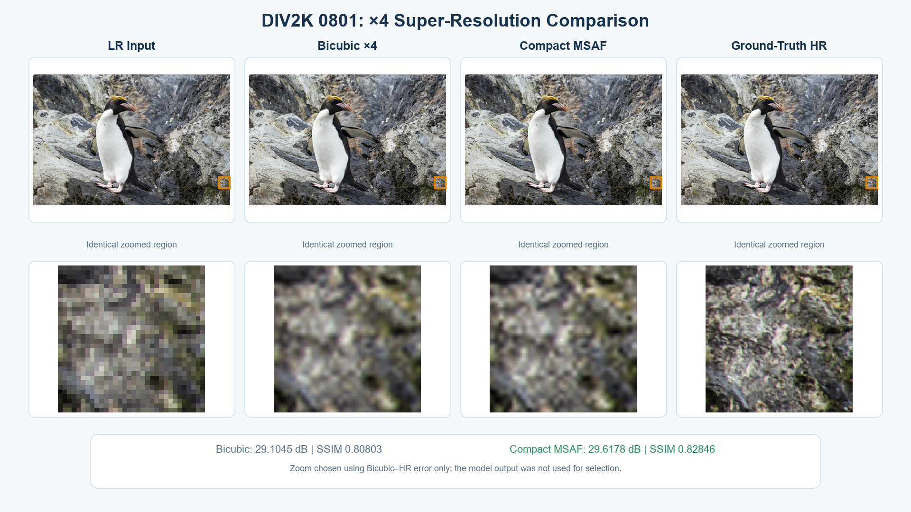
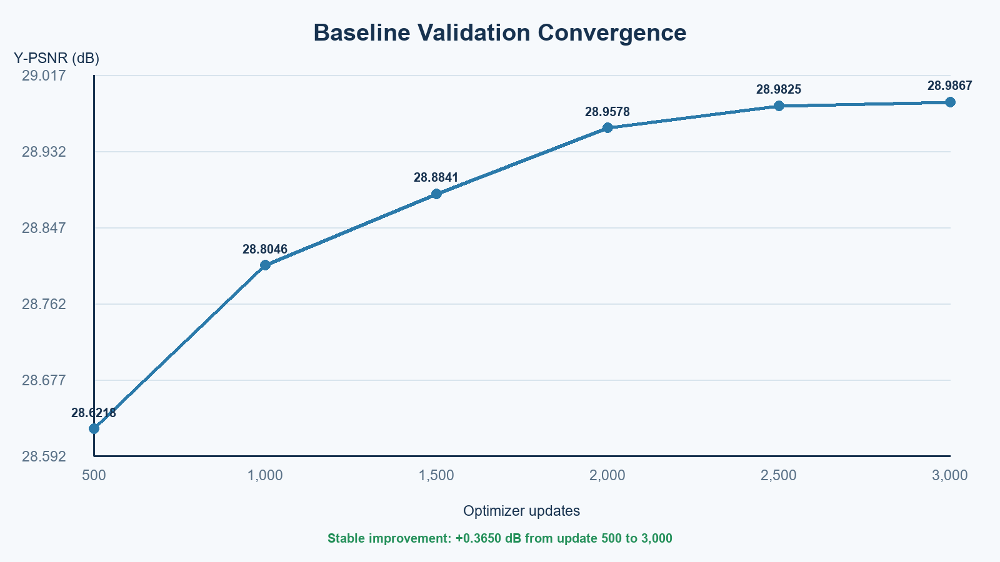
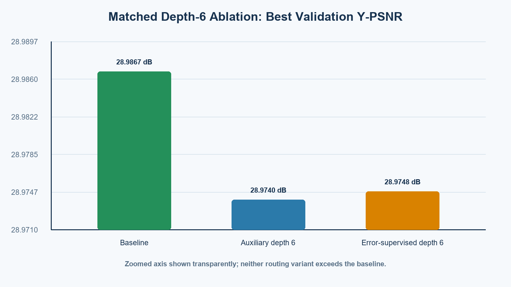
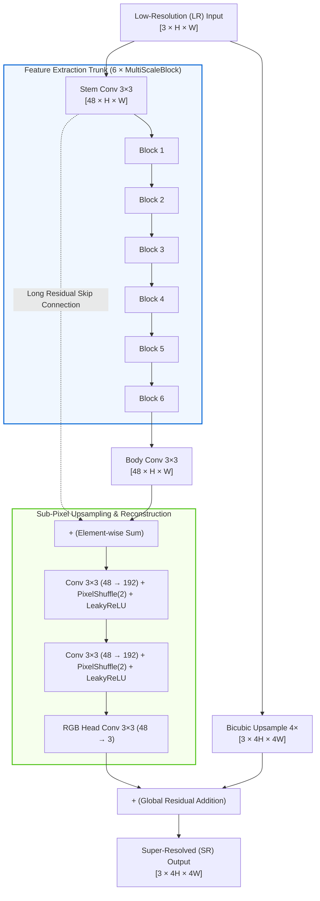

# Multi-Scale Attention Feature Fusion Network for Single-Image Super-Resolution (MSAF-Net)

<div align="center">

[](https://github.com/Likhith1807/Multi-Scale-Attention-Feature-Fusion-Net-for-Single-Image-Super-Resolution/actions/workflows/ci.yml)
[](https://www.python.org/)
[](https://pytorch.org/)
[](LICENSE)
[](docs/architecture.md)
[-76B900?logo=nvidia&logoColor=white)](https://www.nvidia.com/)

**An efficient, deep neural network architecture for $4\times$ Single-Image Super-Resolution (SISR) featuring multi-scale spatial attention, dynamic gating, channel recalibration, and sub-pixel reconstruction.**

[Architecture Deep Dive](docs/architecture.md) • [Reproduction Guide](#-quickstart--reproduction) • [Measured Benchmarks](#-quantitative-benchmarks) • [Methodology Spec](docs/ARCHITECTURE_AND_METHOD.md)

</div>

---

## 📌 Qualitative Showcase

Below are representative qualitative super-resolution outputs ($4\times$) on DIV2K validation samples comparing standard bicubic interpolation against **MSAF-Net**, alongside training loss convergence:

<div align="center">
  
  <p><em>Figure 1: Qualitative 4× comparison on DIV2K validation sample #0801 (Bicubic: 29.10 dB vs MSAF-Net: 29.62 dB, +0.51 dB gain).</em></p>
</div>

<div align="center">
  
  
  <p><em>Figure 2: Empirical training convergence (L1 loss) and Depth-6 candidate PSNR trajectories.</em></p>
</div>

---

## 🧠 Model Architecture

The `CompactMSAF` model consists of **586,077 parameters** designed to deliver sharp edge reconstruction without the quadratic compute footprint of vision transformers:



### Key Architectural Components

1. **Multi-Scale Convolutional Dilation:** Inside each `MultiScaleBlock`, three parallel $3\times3$ convolutions operate with dilation factors $d \in \{1, 2, 3\}$, corresponding to effective receptive fields of $3\times3$, $5\times5$, and $7\times7$.
2. **Dynamic Soft Spatial Gate:** A spatial routing convolution produces $3$-channel position-specific logits, normalized via spatial Softmax:
   $$\mathbf{M}(p) = \sum_{k=1}^3 \text{Softmax}_k\left(\mathbf{g}(\mathbf{F})(p)\right) \cdot \mathbf{B}_k(p)$$
3. **Channel Attention (Squeeze-and-Excitation):** Features are adaptively recalibrated via global average pooling and a two-layer bottleneck MLP ($48 \to 12 \to 48$).
4. **Sub-Pixel PixelShuffle Upsampler:** Two cascaded PixelShuffle stages upscale spatial dimensions ($2\times$ each) to eliminate checkerboard artifacts common in transposed convolutions.
5. **Bicubic Residual Learning:** High-frequency details are learned as a residual offset added directly onto the torch-native bicubic interpolation baseline.

---

## 📊 Quantitative Benchmarks

Measured on the official **DIV2K Validation Set** ($4\times$ downscaling, Y-channel evaluation according to standard SISR protocol):

| Image ID | Bicubic PSNR (dB) | Bicubic SSIM | **MSAF-Net PSNR (dB)** | **MSAF-Net SSIM** | $\Delta$ PSNR | $\Delta$ SSIM |
|:---:|:---:|:---:|:---:|:---:|:---:|:---:|
| `0801` | 29.1045 | 0.8080 | **29.6178** | **0.8285** | **+0.5133 dB** | **+0.0205** |
| `0802` | 35.0816 | 0.8963 | **35.5628** | **0.9043** | **+0.4812 dB** | **+0.0080** |
| `0803` | 35.2727 | 0.9529 | **35.8856** | **0.9558** | **+0.6129 dB** | **+0.0029** |

*All metrics calculated on YCbCr Y-channel after shaving a 4-pixel boundary crop ([`metrics.py`](metrics.py)).*

---

## 🛠️ Technology Stack & Dependencies

| Layer | Technology | Version | Purpose |
|---|---|---|---|
| **Deep Learning** | PyTorch | `2.13.0+cu130` (or `2.0+`) | Model architecture, automatic differentiation, CUDA kernels |
| **Numeric Computing** | NumPy | `>=1.24, <3.0` | Patch sampling, fast array transformations |
| **Image Processing** | Pillow | `>=10.0, <13.0` | Lossless PNG decode, validation crops, visual panel synthesis |
| **Scientific Computing** | SciPy | `>=1.10, <2.0` | High-precision 2D Gaussian kernels for SSIM verification |
| **CI / Automation** | GitHub Actions | Ubuntu & Windows | Multi-OS continuous integration and test verification |

---

## 🚀 Quickstart & Reproduction

### 1. Environment Setup

```bash
# Clone repository
git clone https://github.com/Likhith1807/Multi-Scale-Attention-Feature-Fusion-Net-for-Single-Image-Super-Resolution.git
cd Multi-Scale-Attention-Feature-Fusion-Net-for-Single-Image-Super-Resolution

# Create and activate environment
python -m venv .venv
source .venv/bin/activate       # Linux/macOS
# or: .venv\Scripts\activate    # Windows
```

Install dependencies:
```bash
pip install -r requirements.txt
# For CUDA-accelerated PyTorch:
pip install torch --extra-index-url https://download.pytorch.org/whl/cu121
```

### 2. Run Verification Suite
Verify mathematics, gradient propagation, and data pipeline integrity:
```bash
python self_test.py
python check_environment.py
```
*(All 9 unit tests pass in under 40 seconds on standard hardware).*

### 3. Data Preparation (DIV2K)
Download the official DIV2K dataset archives and place them into `data/archives/`:
- `DIV2K_train_HR.zip`
- `DIV2K_train_LR_bicubic_X4.zip`
- `DIV2K_valid_HR.zip`
- `DIV2K_valid_LR_bicubic_X4.zip`

Extract and verify image pair integrity:
```bash
python download_div2k.py --extract-only
python verify_data.py --data data
```

### 4. Training
Train the baseline MSAF-Net:
```bash
python train.py \
  --run-dir runs/baseline_x4 \
  --steps 3000 \
  --batch-size 16 \
  --crop-size 48 \
  --scale 4 \
  --device cuda
```

### 5. Evaluation & Presentation Export
Evaluate a checkpoint on the validation set and generate presentation-ready qualitative figures:
```bash
python evaluate.py --checkpoint runs/baseline_x4/best.pt --data data --scale 4
python export_presentation_results.py --overwrite
```

---

## 💻 Windows Launcher Suite

For local workstations running Windows with NVIDIA GPUs (tested on RTX 5060), pre-configured batch scripts are provided:

| Script | Purpose |
|---|---|
| `01_SETUP_RTX5060.cmd` | Automatic environment provisioning with CUDA 13.0 |
| `02_VERIFY_RTX5060.cmd` | Hardware verification and baseline CUDA benchmark |
| `03_PREPARE_DATA_OFFLINE.cmd` | Offline extraction and dataset pair checksum validation |
| `04_ONE_PATCH_CHECK.cmd` | Sanity check ensuring model capacity to overfit a single patch |
| `05_TRAIN_PILOT.cmd` | 1,000-update baseline pilot training |
| `06_EVALUATE_PILOT.cmd` | Full evaluation on 10 validation images |
| `07_VERIFY_RESEARCH_UPDATE.cmd` | Regression checks and research training benchmark |
| `08A` / `08B` / `08C` | Matched 3,000-update baseline vs auxiliary vs error-supervised screens |
| `09_COMPARE_RESEARCH_3K.cmd` | Cross-validates configurations and compares test metrics |
| `10_DIAGNOSE_CANDIDATE_DEPTH.cmd` | Forced routing candidate depth sweep (1, 3, 6 blocks) |
| `11_VERIFY_DEPTH6_UPDATE.cmd` | Depth-6 regression tests and memory cost gate |
| `12A` / `12B` | Matched Depth-6 auxiliary and error-supervised screens |
| `13_COMPARE_DEPTH6_3K.cmd` | Summarize and contrast completed Depth-6 screens |
| `14_EXPORT_PRESENTATION_RESULTS.cmd` | Export qualitative comparison panels and training loss curves |

---

## 📂 Repository Directory Layout

```
.
├── .github/
│   ├── ISSUE_TEMPLATE/             # Standard bug report & feature request forms
│   ├── workflows/ci.yml            # Multi-OS continuous integration pipeline
│   ├── dependabot.yml              # Automated dependency alerts
│   └── PULL_REQUEST_TEMPLATE.md    # PR submission checklist
├── docs/
│   ├── assets/                     # Authentic qualitative SR panels & loss curves
│   ├── architecture.md             # In-depth system specification & formulas
│   └── ARCHITECTURE_AND_METHOD.md  # Detailed mathematical research specification
├── scripts/
│   ├── run_self_test.sh            # Unix test runner
│   ├── train_baseline.sh           # Unix training script
│   └── evaluate.sh                 # Unix evaluation script
├── data/
│   ├── README.md                   # Dataset layout instructions
│   └── archives/PUT_ZIPS_HERE.txt  # Dataset placeholder
├── model.py                        # CompactMSAF PyTorch model implementation
├── train.py                        # Training engine with AdamW, L1 loss & checkpoints
├── evaluate.py                     # DIV2K evaluation engine (PSNR/SSIM)
├── metrics.py                      # ITU-R BT.601 YCbCr conversions, PSNR, SSIM
├── pairs.py                        # Paired crop generator & dataset fingerprinting
├── research.py                     # Error-supervised loss targets & routing diagnostics
├── self_test.py                    # Comprehensive 9-test unit & integration test suite
├── verify_data.py                  # All-pair dataset integrity & SHA-256 validation
├── export_presentation_results.py  # Presentation figure and crop export engine
├── check_environment.py            # Hardware, CUDA, and library reporter
├── pyproject.toml                  # Modern PEP 517/518 build and tool configuration
├── requirements.txt                # Core runtime dependencies
├── requirements-lock-5060.txt      # Locked production dependency snapshot
├── .editorconfig                   # Cross-IDE formatting conventions
├── .gitignore                      # Multi-layer exclusions for datasets & checkpoints
├── .env.example                    # Environment variable template
├── CONTRIBUTING.md                 # Contributor guidelines & code standards
├── SECURITY.md                     # Vulnerability reporting & checkpoint security
├── CODE_OF_CONDUCT.md              # Contributor Covenant v2.1
├── CHANGELOG.md                    # Project development history & version logs
└── LICENSE                         # MIT License
```

---

## ⚖️ Engineering Decisions & Trade-Offs

| Decision | Rationale | Trade-Off |
|---|---|---|
| **Dilated Convolutions vs Large Dense Kernels** | Dilation ($d \in \{1, 2, 3\}$) expands effective receptive fields to $7\times7$ without increasing weights beyond $3\times3$ convolutions. | Receptive grids are sparse; requires residual skips to prevent gridding artifacts. |
| **PixelShuffle vs ConvTranspose2d** | Sub-pixel convolution avoids checkerboard artifacts caused by overlapping transposed convolution kernels. | Increases channel dimension by $4\times$ prior to tensor reshaping. |
| **Detached Error Targets in Research Screen** | Stopping gradients on error maps ($q_k$) prevents adversarial collapse and stabilizes gating convergence. | Branch preference targets reflect instantaneous relative errors rather than end-to-end task optimality. |
| **Y-Channel Boundary Shaving (4px)** | Adheres to strict standard SISR benchmarking protocol (NTIRE/DIV2K) to eliminate boundary interpolation artifacts. | Requires color space conversion from RGB to YCbCr before metric computation. |

---

## 🔒 Security & Safe Checkpoint Loading

This project does not require private cloud credentials or API keys. When loading external model checkpoints (`.pt`), ensure untrusted weights are inspected or loaded using PyTorch's `weights_only=True` parameter to prevent arbitrary code execution from malicious pickles. See [SECURITY.md](SECURITY.md) for full details.

---

## 📄 License

This repository is licensed under the [MIT License](LICENSE).
Maintained by **[Likhith1807](https://github.com/Likhith1807)**.
