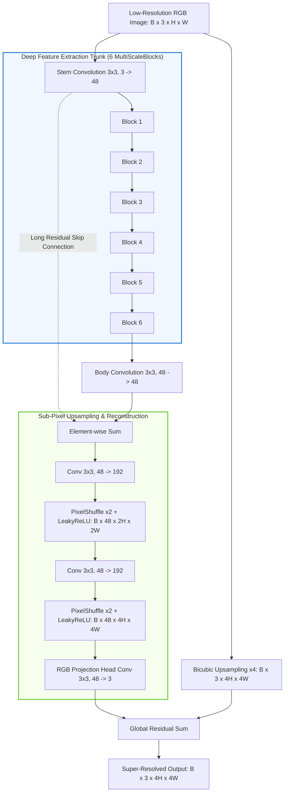
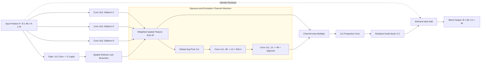

# System Architecture & Technical Specification

This document provides an engineering-level deep dive into the **Multi-Scale Attention Feature Fusion Network (MSAF-Net / CompactMSAF)** for $4\times$ Single-Image Super-Resolution (SISR).

---

## 1. End-to-End Pipeline & Tensor Flow

---

## 2. MultiScaleBlock Architecture

Each block within the trunk extracts multi-scale representations through parallel dilated convolutions, fuses them using dynamic soft spatial gating, recalibrates features via channel attention, and applies residual scaling:

### Mathematical Formulation

1. **Multi-Scale Convolutional Sampling:**
   $$\mathbf{B}_k = \text{LeakyReLU}\left(\text{Conv}_{3\times3, d_k}(\mathbf{F})\right), \quad d_k \in \{1, 2, 3\}$$
   - $d_1 = 1$: Standard dense $3\times3$ spatial receptive field.
   - $d_2 = 2$: Dilated $5\times5$ effective receptive field ($3\times3$ sparse grid with rate 2).
   - $d_3 = 3$: Dilated $7\times7$ effective receptive field ($3\times3$ sparse grid with rate 3).

2. **Position-Wise Soft Attention Gating:**
   $$\mathbf{g}(\mathbf{F}) = \text{Conv}_{1\times1}(\mathbf{F}) \in \mathbb{R}^{3 \times H \times W}$$
   $$w_k(p) = \frac{\exp(g_k(p))}{\sum_{j=1}^3 \exp(g_j(p))}, \quad \forall p \in \Omega$$
   $$\mathbf{M}(p) = \sum_{k=1}^3 w_k(p) \cdot \mathbf{B}_k(p)$$

3. **Channel Attention Recalibration:**
   $$\mathbf{s} = \sigma\left(\mathbf{W}_2 \cdot \text{ReLU}\left(\mathbf{W}_1 \cdot \text{GAP}(\mathbf{M})\right)\right)$$
   $$\mathbf{M}_{\text{att}} = \mathbf{s} \odot \mathbf{M}$$

4. **Residual Scaling:**
   $$\mathbf{F}_{\text{out}} = \mathbf{F} + 0.2 \cdot \mathbf{W}_{\text{proj}} \mathbf{M}_{\text{att}}$$

---

## 3. Parameter and Computational Complexity

| Component | Operation | Kernel / Configuration | Parameters |
|---|---|---|---|
| Shallow Stem | Conv2d | $3 \to 48$, kernel $3\times3$ | 1,344 |
| MultiScaleBlock $\times 6$ | 3 Dilation Branches | $3 \times (48 \to 48)$, kernel $3\times3$ | $6 \times 62,352 = 374,112$ |
| | Soft Attention Gate | $48 \to 3$, kernel $1\times1$ | $6 \times 147 = 882$ |
| | Channel Attention | $48 \to 12 \to 48$, $1\times1$ | $6 \times 1,200 = 7,200$ |
| | Projection Conv | $48 \to 48$, kernel $1\times1$ | $6 \times 2,352 = 14,112$ |
| Body Conv | Conv2d | $48 \to 48$, kernel $3\times3$ | 20,784 |
| Upsampler 1 | Conv2d + PixelShuffle(2) | $48 \to 192$, kernel $3\times3$ | 83,136 |
| Upsampler 2 | Conv2d + PixelShuffle(2) | $48 \to 192$, kernel $3\times3$ | 83,136 |
| Head Conv | Conv2d | $48 \to 3$, kernel $3\times3$ | 1,302 |
| **Total Parameter Count** | — | — | **586,077** |

---

## 4. Controlled Research Extension: Error-Supervised Branch Routing

In addition to standard inference, `research.py` implements a training-only error supervision mechanism:
- Branch candidates $k \in \{1, 2, 3\}$ are evaluated through the downstream trunk and decoder.
- Local reconstruction error $e_k$ is computed against the ground-truth high-resolution patch:
  $$e_k = \text{AvgPool}_{3\times3}\left(\text{Downsample}_{4\times}\left(|I_k^{\text{SR}} - I^{\text{HR}}|\right)\right)$$
- Softmax error preference targets are formed using detached gradients:
  $$q_k = \text{Softmax}\left(-\frac{\text{detach}(e_k)}{\tau \cdot \text{detach}(\bar{e}) + \epsilon}\right)$$
- The spatial gate is supervised by minimizing cross-entropy with target $q_k$, encouraging spatial specialization without changing the final inference architecture or parameter count.
